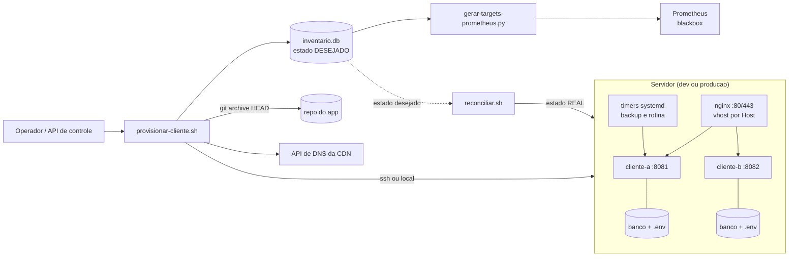

# provisionador-multicliente

🇧🇷 Português · [🇬🇧 English below](#english)

Scripts de **provisionamento multi-instância** em Bash e Python: subir, atualizar, reconfigurar e remover uma instância isolada de um app para cada cliente, em uma ou duas VPS, com **inventário em SQLite**, **units systemd** geradas de templates, **nginx como proxy reverso por cabeçalho Host** e DNS via API.

> **Transparência:** o código foi desenvolvido com auxílio do Claude Code e revisado por mim. A arquitetura (nginx por Host em vez de portas fixas), o diagnóstico do erro 522 e o sudoers restrito foram decisões e trabalho meu. Esta é uma **versão generalizada** de um projeto real: tudo que era específico do app de origem foi trocado por comandos configuráveis (`scripts/config.sh`), e os clientes, domínios e IPs são fictícios (`cliente-a`, `exemplo.com`, `203.0.113.x`). Não inclui o app em si, a API/painel de controle nem o faturamento.

## Problema

Subir um painel novo na mão era um processo de 9 passos e travava em 6 clientes, porque a CDN só permitia 6 portas fixas para o servidor de origem. Cada cliente precisa de instância, banco, segredos, serviço, backup, DNS e proxy próprios, e isolados dos demais.

## Arquitetura



Fluxo de `provisionar-cliente.sh`: valida entrada → resolve o servidor → copia a fonte (`git archive`) → gera `.env` e `.env.systemd` → instala/migra/compila → gera e instala as units → registra no inventário → healthcheck → nginx → DNS.

## Decisões técnicas

1. **nginx por cabeçalho Host, não uma porta por cliente.** Todos os clientes compartilham 80/443 e o nginx roteia por nome (`server_name`). Isso removeu o limite de 6 clientes imposto pelas portas permitidas na CDN. Cada app escuta só em `127.0.0.1:<porta>`.
2. **Inventário como fonte de verdade.** Um SQLite próprio guarda o estado *desejado* (slug, porta, features, servidor, ref de deploy). `reconciliar.sh` aplica o desejado sobre o real (um loop declarativo simples); os alvos do Prometheus são gerados dele.
3. **Um segredo por instância e isolamento por cliente.** Cada cliente tem banco, `.env` e serviço próprios; nenhum segredo é compartilhado. Segredos passam ao `preencher-template.py` por **ambiente**, não por `argv` (visível em `ps`).
4. **Substituição de template em Python, não `sed`.** Um valor com `|` fecha a expressão do `sed` e vira programa (a flag `e` executa shell). `preencher-template.py` faz substituição literal, falha se faltar variável e se sobrar `{{placeholder}}`, e grava o arquivo com modo `0600` desde a criação.
5. **Validação em allowlist** (`validacao.py`): o nome do cliente cai em `.env`, em `Description=` de units e em argumentos de shell; listar o que entra fecha os três vetores.
6. **Node fixado (`fixar-node.sh`).** Quem chama sem o profile do usuário usaria outro Node e compilaria módulos nativos para a ABI errada; o sintoma só aparece em runtime.
7. **`.env.systemd` separado:** o parser do systemd expande `$` em silêncio e zera credenciais que contenham esse caractere.
8. **Atualização segura (`atualizar-cliente.sh`).** Backup do banco antes; apaga só o que o *git* diz que saiu do repo (nunca varredura de diretório); `ref_deploy` fixa a versão que um cliente pode receber, comparando por commit.
9. **Menor privilégio.** O nginx é configurado por `aplicar-nginx.sh`, que valida tudo de novo por dentro porque roda como root; a ideia é liberar `sudo` sem senha **apenas** para esse script (regra de sudoers restrita a um caminho, validada com `visudo -cf`). A remoção tem *dry-run* por padrão, guarda o banco antes de apagar e recusa caminhos rasos ou a pasta-base.
10. **Dois servidores explícitos** (`servidores.py`): o caminho-base de cada servidor é declarado, não derivado da pasta local.

### Pré-requisito de DNS/CDN

Se a CDN só alcança a origem por portas específicas, o firewall do provedor (de borda, fora do SO) precisa liberar a 80. Num caso real o primeiro cliente deu erro 522 por isso; o diagnóstico foi no firewall do provedor, não no servidor.

## Como rodar

Requisitos: Linux com systemd, `nginx`, `git`, `python3`, `sqlite3`, `openssl`, `curl`; acesso SSH por alias (`~/.ssh/config`) ao servidor de produção.

```bash
cp .env.example .env && chmod 600 .env            # token da API de DNS
$EDITOR scripts/config.sh scripts/servidores.py   # seu app, domínio, servidores
python3 -m unittest discover -s tests -v          # testes das partes puras
./scripts/provisionar-cliente.sh --slug cliente-a --nome "Cliente A" --features crm,agenda
./scripts/reconciliar.sh cliente-a crm,agenda,inbox
./scripts/atualizar-cliente.sh cliente-a
./scripts/remover-cliente.sh --slug cliente-a              # dry-run
./scripts/remover-cliente.sh --slug cliente-a --confirmar
```

O app deve: ler configuração de `.env`, expor `<SAUDE_PATH>` (HTTP 200), aceitar `--hostname/--port` no comando de start e, opcionalmente, expor uma rota de rotina periódica e um script de backup. Ajuste isso em `config.sh` e nos templates.

## Limitações conhecidas

- **Não foi testado de ponta a ponta depois da generalização.** As partes puras têm testes (14, passando): validação, resolução de caminhos, templates, inventário e lista de arquivos removidos. Os passos que dependem de SSH, nginx, systemd e da API de DNS vieram do projeto real, mas não foram reexecutados nesta versão.
- **Bug conhecido no original:** os scripts calculavam o caminho da pasta de instâncias a partir da pasta local, o que errava na produção depois de uma troca de usuário. Aqui o caminho-base é declarado em `servidores.py`, mas isso ainda precisa ser validado num segundo servidor.
- Sem rollback automático em `atualizar-cliente.sh` (só o backup do banco).
- Só dois servidores; só DNS da Cloudflare; só SQLite; TLS terminado na CDN (nada de Let's Encrypt aqui).
- Sem medição de tempo economizado: o ganho em tempo de provisionamento **não foi medido**.
- Instâncias fora do layout padrão exigem `--tenho-certeza` para remoção.

---

<a name="english"></a>
# provisionador-multicliente (English)

Bash + Python **multi-instance provisioning**: create, update, reconfigure and remove one isolated app instance per customer on one or two VPS, with a **SQLite inventory**, **systemd units** rendered from templates, **nginx as a Host-header reverse proxy** and DNS via API.

> **Disclosure:** developed with Claude Code's help and reviewed by me. The architecture (Host-based nginx instead of fixed ports), the diagnosis of the 522 error and the restricted sudoers were my decisions and work. This is a **generalised version** of a real project: app-specific parts became configurable commands (`scripts/config.sh`); customers, domains and IPs are fictional. The app itself, the control API/UI and billing are not included.

## Problem

Adding a customer panel by hand took 9 steps and stopped at 6 customers because the CDN allowed only 6 fixed origin ports. Each customer needs its own instance, database, secrets, service, backup, DNS and proxy, isolated from the others.

## Architecture

See the diagram above. `provisionar-cliente.sh` validates input, resolves the target server (local or SSH), copies the source with `git archive`, renders `.env`/`.env.systemd`, installs/migrates/builds, installs systemd units, records the instance in the inventory, health-checks it, configures nginx and finally DNS.

## Key decisions

1. **Host-header nginx, not one port per customer**: removes the 6-customer ceiling; apps bind to `127.0.0.1` only.
2. **Inventory as source of truth** (desired state); `reconciliar.sh` applies desired over actual; Prometheus targets are generated from it.
3. **One secret per instance**, passed via environment rather than `argv` (visible in `ps`).
4. **Literal template substitution in Python, not `sed`** (a `|` in a value can become a program through GNU sed's `e` flag); fails closed on missing variables or leftover placeholders; files written `0600`.
5. **Allowlist validation** for the customer name, which ends up in `.env`, unit descriptions and shell arguments.
6. **Pinned Node** so native modules are built for the same ABI the service runs.
7. **Separate `.env.systemd`** because systemd silently expands `$`.
8. **Safe updates**: DB backup first; delete only what *git* says left the repo; per-customer `ref_deploy` pin compared by commit.
9. **Least privilege**: the root-run nginx script revalidates everything; passwordless sudo is meant for that one script only; removal is dry-run by default, saves the DB first and refuses shallow paths.
10. **Explicit per-server base path** instead of deriving it from the local folder.

## Running

See the commands above. Edit `scripts/config.sh` and `scripts/servidores.py`, put the DNS token in `.env`, run the tests, then provision.

## Known limitations

Not re-run end to end after generalisation (14 unit tests cover the pure parts); the path-derivation bug of the original is addressed by declaring base paths but is unverified on a second server; no automatic rollback on update; two servers, Cloudflare DNS and SQLite only; time saved was **not measured**.

## License

MIT
